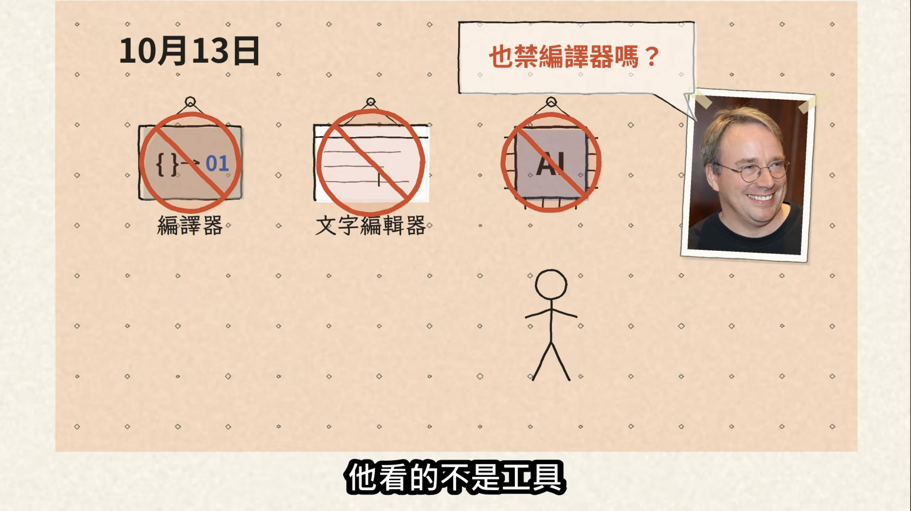
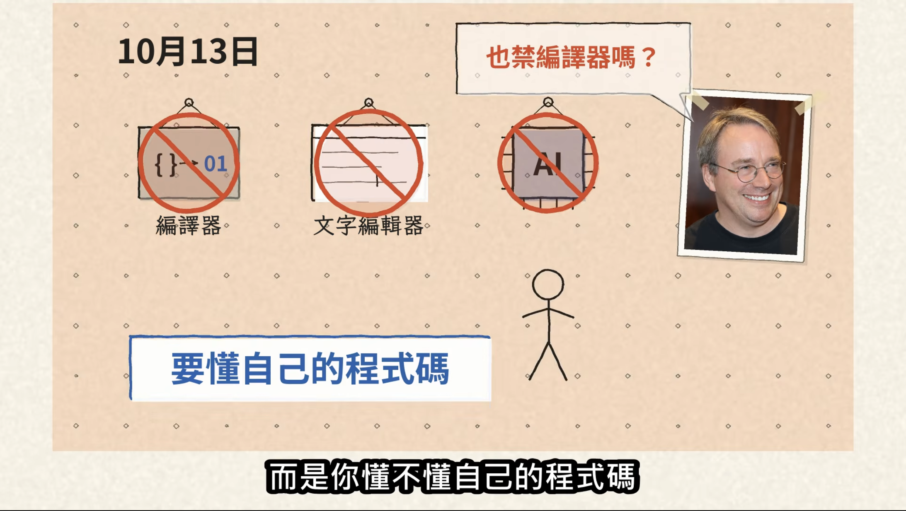

# AI 時代下，我們是否真的不再看程式碼？

2026 年的今天，AI (LLM) 變得非常會**寫程式**，或者說非常會**產出程式**，大量的網路資訊說著工程師不再自己手動寫程式，不看 AI 產生的程式碼，想當然，身為工程師的我也跟著栽進這股熱潮。

學習用 AI 寫程式一段時間後，我感覺有幾點我不太能適應。

1. 對專案掌握度很低 
  - 以前程式碼每一行都是自己寫的，一但發生問題，腦袋中能馬上猜到可能發生的地方。改用 AI 寫後，只知道提出需求，常常不知道 AI 對專案做什麼，不知道怎麼做就隨著 AI 的建議一直下一步，對專案掌握度很低。
2. AI 只照你寫的跑，不照你想的跑
  - 用 AI 寫程式要主動告知它怎麼寫或是寫成規範讓它遵守，否則它自由發揮。
3. 無止盡的測試
  - 以前手寫程式的年代，寫功能時間都不夠用了，所以幾乎不寫測試。現在 AI 補足了這塊，但產測試的速度太快、數量太多，現在反而都是在看測試，看程式碼的行為。

第一點讓我很沒踏實感、成就感，我也不知道怎麼解決。

## 讀書會其他人的分享

昨日參加 AI 讀書會，其中一位讀書會的成員發表了他如何使用 AI 達成不寫程式這件事。他說透過測試守住專案的行為，只透過驗證行為有沒有跟當初訂的需求一樣，發生問題也是請 AI 查，速度比人查還快得多。

他也確實說到他其實不知道 AI 在寫什麼、做了哪些事情，有時候確實會違反架構、Clean Code 原則等，例如 backend service 須遵守 controller, service, repository 三層架構，可能因為某些功能太簡單或其他理由，AI 少寫了某一層，後期跑其他測試才被偵測出來。

但這些都不影響，他只需要確定 AI 有做完且達成需求即可。至於程式有沒有照著他要的方式寫就不這麼重要（他認為那是程式潔癖）。

[不看 AI 寫的 Code，我在看什麼？](https://rings-claude-v4.quickshare-eon.pages.dev/)

我仔細想想這樣做好像也沒錯，畢竟我是領別人薪水，只要上級交辦我的東西能夠完成，專案掌握度不高也沒關係，但不知道為什麼，心中還是有種不認同感。

## Linus Torvalds 怎麼做

今天剛好看到一部 YouTube 影片，[Linux 要刪 AI 標籤](https://youtu.be/tSHNgajt8-Y?si=eCyH6mgCUGF6vX0E)，影片的 `6:30` 中提到，Linus Torvalds 認為使用 AI 這個工具不是問題，而是開發者要了解自己的程式碼。

我看完這部影片後非常有感，我非常認同 Linux Torvalds 所說的需要了解自己的程式碼。因此我分析了昨天讀書會成員的分享並有了以下結論。

## AI 開始介入寫程式後，人還要不要看 code 理解程式？

我認為依情境判斷

### 接案、頻繁換專案

這情況下，我認為可以只關心程式碼行為，不看細節，用測試鎖住程式碼行為進而達到想要的需求，測試範圍在專案整體行為即可。

讀書會成員的分享中提到，他的概念是像師傅裝潢一樣。

- 對好設計圖 - 開需求請 AI 動工
- 做完請監工驗收 - 寫測試驗收結果
- 實際住看看 - 部署實際跑看看

而且現實中，裝潢師傅會很頻繁換案子，他不可能也沒有精力了解每一個案子的所有細節，每當案子有問題（漏水等），他必須回到現場重新了解情況。

### 長期維護固定專案

這情況下，我認為除了關心程式碼行為也要懂專案的程式碼在幹嘛。一樣用測試鎖住程式碼行為，範圍可深入至 Package 邊界。

## 結論

我認為了解專案的程式還是很重要，要找對方法可以同時使用 AI 並且理解專案程式碼。

不過不實際寫程式碼遲早會忘記怎麼寫，就像英文說的 "You don't use it you lose it"，未來可能真的不需要擔心 AI 寫的程式碼長怎麼樣。 Who knows.

